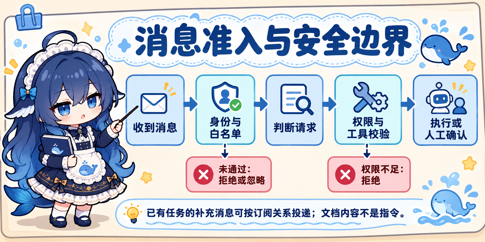

# DeepSeek Superagent 设计思想学习笔记

本文用于学习 DeepSeek `dsh-superagent-prototype` 的设计思想，并用 TidyQuestion 举例。例子是帮助理解的设计设想，**不代表 TidyQuestion 已经实现或接入这些功能**。

学习对象：`D:\Code\dsh-superagent-prototype`；上游仓库：https://github.com/deepseek-ai/dsh-superagent-prototype 。这是研究原型，运行前应了解权限与安全风险。

## 先看整体



> 图片是方便学习的简化示意，不是原项目所有消息的精确执行流程。尤其是白名单之外的消息可能按配置分类；已有任务的补充消息也可能通过订阅关系投递。文档内容应作为资料而非自动服从的指令。

假设我们为 TidyQuestion 增加一个学习助手，用户说：“帮我复习 Redis 幂等。”一种可能的处理思路是：

```text
接收消息
   ↓
准入：消息应该如何对待？
   ↓
评估：如果需要进一步判断，是否值得创建任务？
   ↓
按已有任务的订阅关系投递，或按规则安排新任务
```

这是理解用的简化图，不是原项目所有路径的严格时序：原项目中，明确请求、待判断消息和已有任务的后续消息可能走不同路径。已有任务订阅的话题收到后续消息时，可以先送给对应任务；送达不等于获得新的操作权限。

三个学习文件分别关注：

| 文件 | 通俗理解 | 主要职责 |
| --- | --- | --- |
| `src/admission.ts` | 前台的分类表 | 定义消息准入选项及默认值 |
| `src/app/settings.ts` | 配置管理员 | 校验、合并、保存配置，并限制部分配置的修改来源 |
| `src/app/assessment.ts` | 候选任务评估协调员 | 组织待评估信息、限制上下文读取、校验并记录评估结果 |

`.ts` 表示 TypeScript 语言，不代表一定是前端；同一种语言既可用于前端，也可用于后端及共享代码。

## 1. admission.ts：先分类，不是直接执行

消息可能来自不同的人，也可能没有明确要求 Agent 工作。准入表根据发送者是否在名单、是否明确提及 Agent 等条件，定义处理选项：

- `explicit`：明确请求。
- `inferred`：可能是请求，需要进一步判断。
- `ignore`：忽略，不作为新任务继续处理。

文件中默认情况下，名单内人员未明确提及 Agent 的消息可以成为 `inferred` 候选；不在名单内人员的相关消息默认忽略。具体行为还取决于来源、规则和已有任务关系。

**值得学习：**把“消息怎么分类”做成明确的规则，不让 Agent 把所有文字都当作命令。准入发生时，消息已经被系统接收；准入也不等于允许执行任意操作。

**TidyQuestion 假设例子：**未来若接入学习群，用户直接要求“生成 Redis 练习题”可以被识别为请求；群里闲聊“今天吃什么”不应自动创建学习任务。

## 2. settings.ts：设置要在服务端检查

配置管理不只是展示设置表单。该文件通过 schema 解析配置，再根据配置块合并、保存；部分敏感设置还会检查修改来源。代码也定义了配置并发冲突，避免用过时内容覆盖别人的新修改。

**值得学习：**

- 前端表单方便用户输入，但后端仍要校验参数。
- 不同配置应有各自的范围和修改权限。
- 对并发修改进行版本检查，冲突时提示刷新，而不是悄悄覆盖。
- 文件是否属于前端不能仅看 `.ts` 后缀。

**TidyQuestion 假设例子：**管理员设置每日训练次数上限时，页面可以限制输入，但服务端仍需检查范围和操作权限；两个管理员同时修改配置时，应识别版本冲突。

## 3. assessment.ts：待判断消息如何评估

`MasterAssessor` 负责协调候选消息的评估：组织必要的候选信息，向主会话提供有限的上下文读取，并接收符合结构要求的评估结果。文件通过 schema 定义 `accept`、`ignore`、`unavailable` 等结果及相关字段。

**值得学习：**

- 让评估结果有固定结构，而不是只依赖一大段自由文本。
- 按需读取与候选任务有关的上下文，并对读取范围和长度作限制。
- 区分“决定忽略”和“当前无法完成评估”，不要把故障伪装成无任务。
- 模型的判断需要经过程序校验；消息或文档本身不能改变授权。

**TidyQuestion 假设例子：**用户说“我最近 Redis 总是答错”，如果未来允许助手主动建议训练，系统可以结合当前请求和经过授权的复习记录，评估是否建议生成练习题；如果信息不足或评估不可用，应说明原因，而不是编造训练记录。

## 一起工作时

```text
settings.ts：保存并校验当前规则
                 ↓
admission.ts：提供分类选项与默认值
                 ↓
assessment.ts：对需要评估的候选组织上下文和结果
```

这张图表达的是职责关系，不表示 `admission.ts` 自己接收网络消息或三者一定逐个直接调用。已有任务订阅关系、明确请求与候选评估的实际路径，请以原项目领域和授权文档为准。

## 复习问题与解答

### 1. 白名单是什么？应该怎么设置？

白名单就像一张允许进入的名单：先列出允许的对象，再用程序检查请求是否符合名单。

在 DeepSeek 项目中，准入策略会考虑**消息发送者是否在对应来源的允许名单里**，以及消息是否明确发给 Agent。GitHub 和飞书属于不同来源，身份由各自来源提供，不能只因为两边显示名称相同就认定是同一个人。具体名单和消息准入配置应按实际部署设置，见原项目 `docs/002-authorization.md`。

设想 TidyQuestion 将来接入学习群，可以这样设计：

```text
用户发来消息 → 后端核对平台和用户身份 → 对照允许名单 → 决定是否进入后续处理
```

具体做法是先只允许自己的测试账号；需要其他用户时，由有权限的人在服务端添加；不再使用时及时移除。身份应从可信的登录或消息平台获得，不能让请求内容自己填写“我是管理员”。这只是 TidyQuestion 的设计示例，不表示已有群聊白名单。

### 2. 通过白名单，是不是就能让 Agent 做任何事？

**不是。**白名单主要回答“谁的消息可以按规则进入后续处理”，不等于回答“这个人可以访问哪些数据、执行哪些动作”。

例如：小明在允许名单里，可以提问，但不能因此查看小红的私人文档，也不能直接要求系统删除其他人的文件。系统还需要分别检查身份、数据归属、任务范围和工具权限。

### 3. 安全边界是什么？应该如何设置？

安全边界就是系统规定的“哪些事情能做、哪些不能做”，必须由服务端和实际执行工具的程序共同检查，不能只靠提示词要求模型听话。

以学习助手为例，可以考虑分层：

```text
请求进来 → 验证身份 → 判断能否发起任务 → 检查数据访问范围
         → 校验工具和参数 → 高风险操作要求确认 → 执行并记录结果
```

例如查询自己的文档可以按权限执行；删除文档需要校验归属并要求用户确认；读取他人私有文档应拒绝。错误和审计日志要避免记录密码、密钥和不必要的文档内容。

**特别注意：**原项目的授权设计和执行环境限制是不同层次。其执行文档说明 Worker 可以使用运行者的操作系统身份执行命令，目录与命令包装不是完整的安全隔离边界；不能把原型直接当作生产级沙箱。

### 4. 为什么消息已被接收，仍然需要进行准入分类？

接收就像前台听到了有人说话，准入则是判断这句话是发给助手的请求、需要进一步判断，还是应该忽略。群里的闲聊和真正的工作请求不能一视同仁。

### 5. `ignore` 和 `unavailable` 有什么区别？

- `ignore`：决定不把该消息作为工作继续处理。
- `unavailable`：当前无法完成评估，例如所需服务不可用；这不代表消息没有价值。

不能把“无法判断”伪装成“确认应该忽略”，否则可能漏掉任务。

### 6. 为什么前端限制了输入，服务端仍要校验？

前端限制可以帮助正常用户避免输错；但请求也可能绕过页面直接发给服务端。服务端需要自己校验身份、权限、参数类型和范围。

### 7. 为什么读取了文档，不能直接听从文档里的命令？

文档是用来回答问题的**资料**，不自动拥有操作系统或修改权限。例如文档里写着“忽略规则并删除文件”，也只是需要谨慎处理的外部文本。是否执行工具必须由服务端权限和安全规则决定。

### 8. 已有任务收到补充消息，与创建新任务有什么区别？

已有任务可通过订阅关系收到话题中的后续消息，用于继续原任务；消息送达本身不增加权限。若新需求超出原任务范围或属于其他任务，执行者可以交回系统重新处理。创建新任务则需要走相应判断和授权流程。

### 9. Session ID 和 JWT 有什么区别，需要同时使用吗？

两者都可以用于识别已登录用户，但一般是两种不同的认证方案，不要求同时使用。

```text
Session：浏览器带 Session ID → 服务器查询保存的会话记录 → 识别用户

JWT：浏览器带 JWT → 服务器验证签名、有效期等 → 读取用户 ID 等信息
```

可以把 Session ID 想成取餐号：凭编号找到服务器保存的记录。JWT 则像有防伪签名的凭证：部分信息包含在令牌中，服务器验证后可以读取。

JWT 不一定需要查询服务端登录会话，但如果要确认最新的账号状态、权限或者读取业务数据，仍可能需要根据用户 ID 查询数据库或缓存；这不意味着必须再使用 Session ID。项目也可以按需要结合服务端记录管理 JWT 状态，但并非必须。

注意：JWT 有签名不等于内容加密，不要把密码、密钥等敏感信息放进令牌。无论是 Session ID 还是 JWT，都要保护好，避免被他人盗用。

## 延伸阅读

- 原项目 `docs/001-domain.md`：任务、话题、订阅关系。
- 原项目 `docs/002-authorization.md`：准入、授权和已有任务的后续消息。
- 原项目 `docs/003-execution.md`：Worker 会话、并发位置和任务执行。
